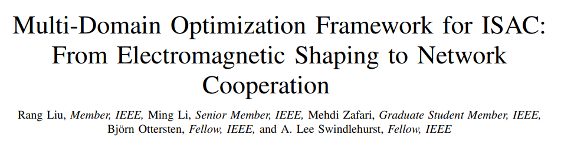
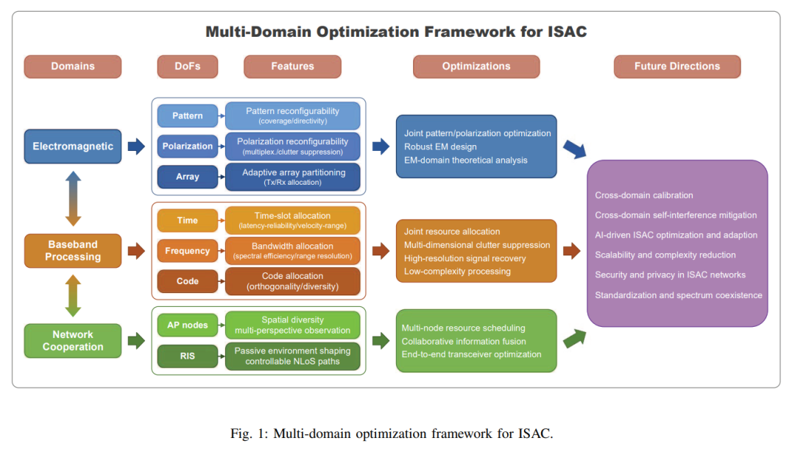
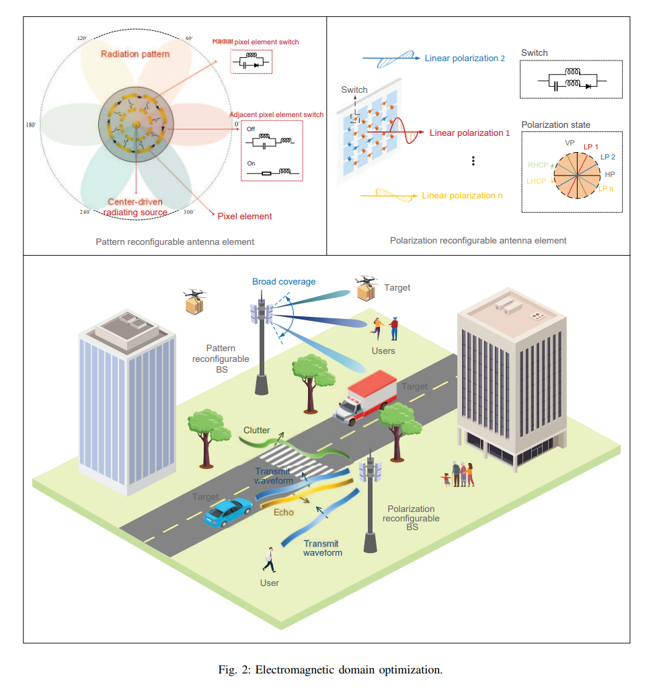
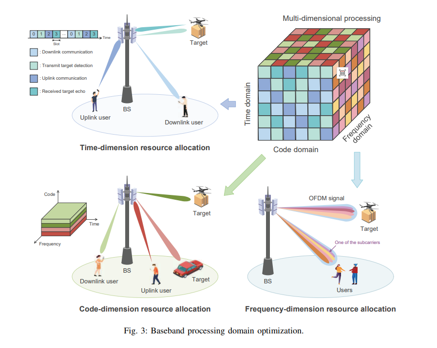
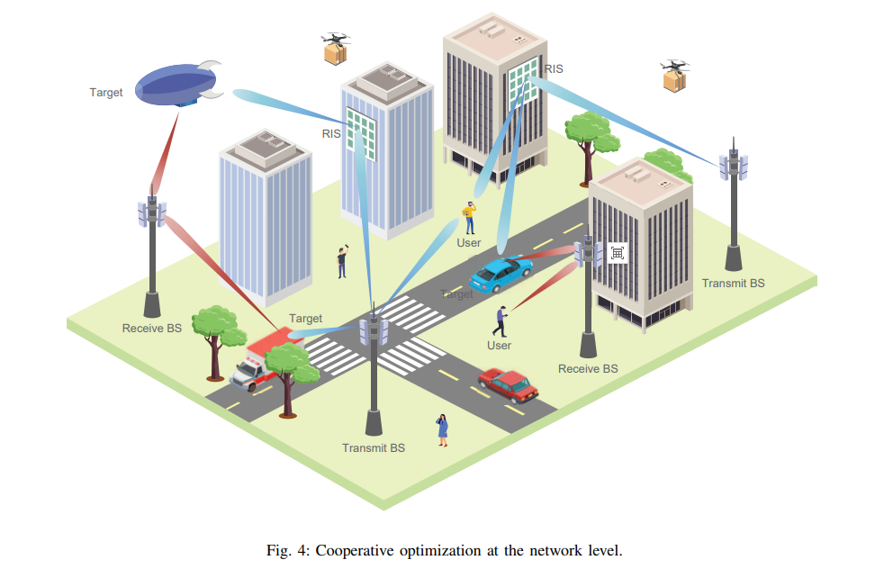
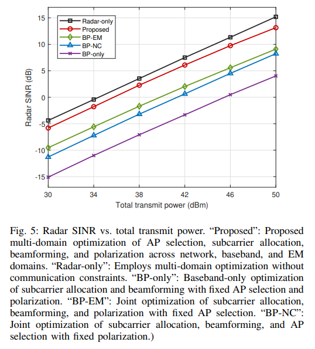

# ISAC: From Electromagnetic Forming to Network Collaboration: ISAC Multi-Domain Optimization Framework Unlocks 6G Perception - Communication Challenges [with MATLAB Code]

Title: ISAC Multi-Domain Optimization Framework: From Electromagnetic Shaping to Network Cooperation
Abstract: Integrated Sensing and Communications (ISAC) has become a key feature of the sixth-generation (6G) network, providing an opportunity to meet the dual demands of communication and perception. Existing ISAC research primarily focuses on baseband optimization at individual access points, with limited attention paid to the role of electromagnetic (EM) shaping and network cooperation. The complex interdependencies between these domains have not been fully explored, nor have their full potential for enhancing ISAC performance been realized. To fill this gap, this paper proposes a multi-domain ISAC optimization framework that integrates EM shaping, baseband processing, and network cooperation strategies to achieve efficient resource management and system-level design. It analyzes the basic trade-off relationships among these domains and delves into domain-specific and cross-domain strategies that can enhance ISAC performance and efficiency. Case studies validate the effectiveness of joint multi-domain optimization, discussing critical challenges and future research directions to bridge theoretical advancements with practical ISAC deployment. This research lays the foundation for an intelligent, scalable ISAC architecture and provides an important reference for seamless integration into next-generation wireless networks.
Introduction: The rapid expansion of wireless services and the prevalence of smart devices have intensified the demand for high-speed connectivity and precise environmental perception. The feasibility study of 3GPP Release 19 and emerging service requirements highlight that ISAC is a potential core vertical area for 6G networks. ISAC supports various applications from enhancing traffic safety with automotive radar to high-precision positioning in dense urban environments, while maintaining reliable wireless connections. By allowing communication signals to serve as radar detection signals simultaneously, ISAC can reduce hardware costs, alleviate spectrum congestion, unlock transformative capabilities for advanced applications such as autonomous driving connected vehicles, industrial Internet of Things, smart infrastructure, and real-time environmental monitoring, and enhance spectrum and energy efficiency, strengthening the robustness and intelligence of network operations.
However, ISAC systems face inherent challenges: they require medium-power transmission and stable data throughput for communication, while perception requires higher power to detect distant or weakly reflective targets, exacerbating self-interference; communication systems prefer short symbol durations (low latency) and long frames (error correction), while perception requires longer coherent time (precise speed measurement) and short pulses (close-range echo resolution), and often requires wider bandwidth for high-distance resolution. These differences complicate resource allocation, hardware design, and interference management, urgently necessitating comprehensive optimization methods beyond traditional waveform centered solutions.
Existing research has mostly focused on waveform and beamforming optimization at the baseband and radio frequency stages, but has not fully considered the electromagnetic domain — antenna array configuration determines the key characteristics of the radiated signal and array response. Ignoring electromagnetic domain optimization can limit system flexibility, and issues such as clutter interference and weak target echoes in complex environments further complicate the implementation of ISAC. Therefore, this paper proposes an integrated multi-domain optimization framework for ISAC, which achieves intelligent resource management, effective interference suppression, and improved perception-communication tradeoff through cross-layer coordination.
The method briefly introduces the core approach of this paper is to construct a multi-domain collaborative optimization framework covering three key domains, with core optimization strategies for each domain as follows:
Electromagnetic Field Optimization: Reconfigurable antennas are utilized to dynamically adjust the radiation pattern and polarization. The allocation of reception and transmission functions is distributed through array segmentation, with joint optimization of the radiation pattern and polarization parameters. Robust design considering hardware defects and electromagnetic field theory performance analysis are also considered to adapt to heterogeneous propagation channels.
2  
Baseband Processing Field Optimization: Resource allocation is performed in time, frequency, and code dimensions (such as slot allocation, bandwidth allocation, and adaptive code allocation). Combining multi-dimensional adaptive clutter suppression, high-resolution signal recovery, and low-complexity processing techniques, a balance between perception accuracy and communication spectrum efficiency is achieved.
3  
Network Collaboration Field Optimization: Based on a multi-node architecture, the configuration of access points (AP) and intelligent reconfigurable surfaces (RIS) is optimized. Through multi-node resource scheduling, collaborative information fusion (signal level, feature level, decision level), and end-to-end transceiver joint optimization, spatial diversity, coverage range, and perception-communication synergy performance are enhanced.
Case study employs an uncell MIMO-OFDM system equipped with polarimetric reconfigurable antenna arrays, with 6 distributed APs serving 8 single-antenna users and detecting a single radar target. By decomposing into AP/subcarrier resource allocation and beamforming/polarization optimization subproblems, the effectiveness of the framework is verified.
Conclusion: The proposed multi-domain optimization framework for ISAC systems provides cross-domain coordination research guidance by connecting electromagnetic resource management, baseband processing, and network collaboration. It breaks through the limitations of traditional separate designs, fully tapping into the potential for synergy across domains. Case studies confirm that it significantly improves perception performance while meeting communication rate and power constraints.
Future deployment of ISAC requires addressing core cross-domain challenges: cross-domain calibration and hardware defect compensation, cross-domain self-interference suppression, AI-driven real-time optimization and adaptation, scalability and complexity reduction for large-scale architectures, network security and privacy protection, and standardization and spectrum coexistence. Future progress in intelligent optimization and standardization will be key to realizing efficient, scalable ISAC systems and integrating them seamlessly into next-generation wireless networks.
End

## Images

<!-- PAYMENT_BLOCK -->

## Get this dataset

- Payment link (Stripe): [Buy now](https://buy.stripe.com/3cs8yP7sY87d0vu9AB)
- Payment QR code: 

<!-- /PAYMENT_BLOCK -->
